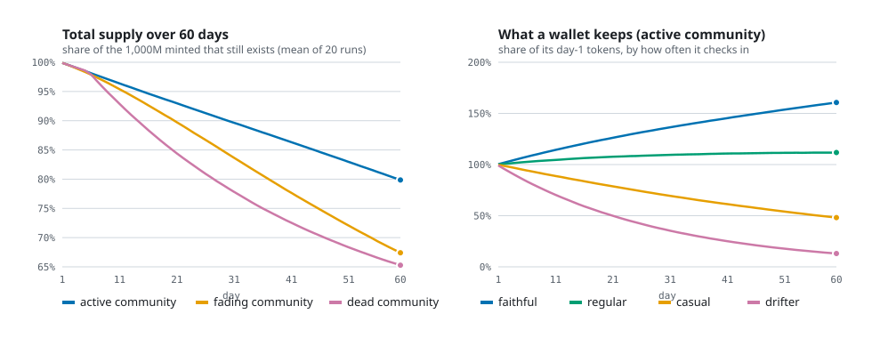

# Rulecard

**Rulecard is a league of memecoins whose communities go to war, and the war is on chain.**

Each coin is its own NEP-141 contract with a daily **Ritual** (the whole community has to show up or its bags burn), a **Vault**, rule
cards and **raids**: one coin attacks another through real cross-contract calls, and the community that shows up in bigger numbers
takes 15% of the loser's pot. The factory that launches the coins deletes its own key in its deploy transaction, so nobody can change
a rule or print an admin.

```
 every day the WHOLE coin has to show up: enough wallets say gm, enough NEAR gets locked in the Vault
              made ◄──────────────────────┴──────────────────────► missed
   the pot buys & burns 5% of itself                    sleepers' bags burn twice as fast
 coins RAID each other: the stronger community takes 15% of the other coin's pot
 lock in the Vault ──► safe from every burn, and you earn what the sleepers lose
```

**Live on NEAR testnet (demo scale):**
- Factory: [`demo2.harshtest1.testnet`](https://testnet.nearblocks.io/address/demo2.harshtest1.testnet) (zero access keys: its only key was deleted in the deploy transaction)
- Coins: [`frog.demo2.harshtest1.testnet`](https://testnet.nearblocks.io/address/frog.demo2.harshtest1.testnet) · [`moth.demo2.harshtest1.testnet`](https://testnet.nearblocks.io/address/moth.demo2.harshtest1.testnet) · [`zap.demo2.harshtest1.testnet`](https://testnet.nearblocks.io/address/zap.demo2.harshtest1.testnet) (each has zero access keys and no admin; its icon is drawn by the contract from the coin's own state)
- App: **https://rulecard-lime.vercel.app** (press PLAY: no wallet, no sign-up). To run it yourself: `npx vite --mode testnet`, see [docs/deploy.md](docs/deploy.md)

Track: **Memecoins With Mechanics** (NEAR).

## Judges: start here (5 minutes)

| Press this | You will see |
|---|---|
| Open the app, press **PLAY** (no wallet, no sign-up) | a practice wallet is made, funded and buys its first bag: real testnet transactions, each with a receipt link |
| Open **War Map** | every coin ranked by level and Ritual streak, its high score, who is raiding whom right now, and the latest raid results. Bots are marked 🤖 wherever their names show (the Log and the raid lists) |
| Open a coin, tab **Ritual** | today's progress, time left, the streak, the coin's best streak ever (its high score) and the last 7 days |
| Press **gm** | one check-in per 6 hours (30 minutes in demo mode). Press it again and the contract refuses |
| Open **Judges**, press **Try it** on each row | six forbidden transactions sent live; each is refused with NEAR's own error and a **REJECTED BY NEAR** stamp |
| Same page, **Live proof** | zero access keys, no admin, one code hash, supply adds up to the token, the curve is fully backed |
| Look at the coin's icon in a wallet or explorer | it is drawn by the contract from its own state: level, streak, the last 7 Rituals (flame or ash), crossed swords in a raid |

**The track names four kinds of mechanic. Rulecard has all four in one contract:**

| The track asks for | Rulecard's version |
|---|---|
| Supply that reacts to the community | idle burn (1% of unlocked tokens per 6h after 24h without a gm), the Vault, the Ritual burn |
| Treasuries with rules | the pot: 1.5% of every trade feeds it, and only fixed rules (Ritual, Ember, Inferno, Ghost Ember, raid spoils) can spend it, at most 75% a day |
| Onchain rituals | the Daily Ritual: gm count plus NEAR locked, a streak, a high score, made or missed |
| Challenges | raids between coins, Prophecy (a 2h crowd bet), Omens |

**What is labelled:** 16 🤖 bots keep the demo world moving (check in, lock, play cards, start raids). Their whole brain is one readable file,
[`sandbox/bots.mjs`](sandbox/bots.mjs). Nothing else in the world is faked: every number comes from the chain.

**Against the judging criteria**

| Criterion | Where to look |
|---|---|
| Technical | 56 coin tests and 7 factory tests at real and demo scale, a randomized fuzz test (900 operations by default, 2,500 in CI, and a 12,000-operation run that passes; invariants checked after each), CI, a live Proof page |
| Innovation | coins raiding coins (cross-contract), one-tap check-ins with function-call keys, a coin whose icon is its war record |
| Track fit | all four mechanic kinds above, a streak with a high score, parameters fixed and readable, a 60-day simulation before choosing them |
| Execution | no-wallet play, a hosted app, a judge page that tries to break it, honest limits below |

## Attacks we found and fixed (from three real red-team passes)

| Attack | Fix | Test or check |
|---|---|---|
| A caller could ask a raid to settle with 100% of the loser's pot | the defender works out the spoils rate itself | raid settlement tests |
| Someone creates an impostor `coin.<factory>` account | the factory deletes its only key in the deploy transaction | the Proof page shows 0 keys |
| A function-call key could sell your tokens | sell, lock, leave early and bet need 1 yoctoNEAR; function-call keys can't attach a deposit | "Try to cheat it" row 1, `selling_needs_one_yocto` |
| Unlock and relock the same tokens to farm the Ritual's lock target | each wallet's tokens count once per day | `relocking_the_same_tokens_counts_once_for_the_ritual` |
| Register ~0.0075 NEAR of wallets to fake a Prophecy crowd | the Crowd question counts wallets whose buys reach 1 game NEAR | Crowd tests |
| Idle burn charged on tokens a wallet just won | winners are settled before payouts | `prophecy_caster_share_settles_idle_burn_first` |
| Pot-card chips stuck if a coin graduates first | chips are refunded at graduation | table tests |
| Holder growth eating curve NEAR | every holder pays the full storage of their own record | storage tests |

## The mechanic in one minute

| Ritual | What you do | What the coin does |
|---|---|---|
| **gm** | tap once every 6h | +1 Energy for the coin, your idle clock resets, counts toward today's Ritual |
| **Daily Ritual** | the coin needs X wallets to gm and Y NEAR to be locked today | made: the pot buys and burns 5% (7% on a 3-day streak). Missed: idle burn ×2 for 6h |
| **Omens** | on coins at level 2+, a one-hour Omen every 3 hours (2h break), rolled from the block's random seed and announced 15 min ahead | Full Moon (Energy ×2), Thunder (sells pay 1% more into the pot), Ghost Ember (the pot burns 3%), Treasure (one lucky gm gets a free pack) |
| **Vault** | lock tokens for 6h / 24h / 72h | locked tokens are safe from every burn and earn half of what idle burn and early exits take |
| **Idle burn** | nothing: it is the cost of not showing up | after 24h without a gm, 1% of your *unlocked* tokens every 6h: half burned, half to the Vault |
| **Cards** | claim 2 cards every 6h; play them with other holders | Ember and Inferno burn from the pot; Prophecy is a 2h crowd bet; raid tactics fight other coins |
| **Raids** | sign, plan 3 hidden tactics, buy, lock and Battle cry in 3 rounds | the loser's pot pays 15% to the winner, which buys and burns its own tokens |

**Supply reacts to the community:** active wallets and lockers keep their tokens; idle wallets shrink; the Ritual and pot cards
burn supply when the crowd shows up. Every mint and burn is logged on-chain and shown on the coin page.

## Why NEAR

What this build uses that other chains don't give you as cleanly:

| NEAR feature | How Rulecard uses it |
|---|---|
| **Named sub-accounts with their own contract** | each coin is `frog.<factory>`, a real NEP-141 account that wallets and explorers see. The factory deploys it and then **deletes its own only key in the same transaction**, so nobody can create an impostor coin under it or change the code new coins run. Check it on the explorer: the factory shows 0 access keys |
| **Function-call access keys** | **one-tap actions**: after one wallet approval, gm, claiming packs, backing cards and Battle cry sign with a key limited to *that coin* and a short list of methods, with no popup. Every call that moves money needs 1 yoctoNEAR (like `ft_transfer`), and a function-call key can never attach a deposit, so it can't sell, lock, bet or buy. `onetap.test.ts` proves this on a real chain |
| **Async cross-contract calls with callbacks** | raids are two contracts agreeing on a result: one exchange to read the defender's scores, one to move the spoils, and a callback that puts the NEAR back in the pot if the transfer fails |
| **Pay-for-what-you-use storage** | each holder pays the storage of their own record (0.0125 NEAR), so a coin never subsidises its growth out of its curve |
| **Cheap enough gas to make rituals real** | a gm every few hours only works as a mechanic when a call costs a fraction of a cent |

Not used yet (roadmap): gasless check-ins through meta-transactions, buying a coin from another chain with NEAR Intents, and
graduating into a Ref Finance pool.

## Two ways in

The hosted app opens on two doors into the same game, both on NEAR testnet with real transactions:
- **PLAY (practice):** free, no wallet, no popups. A throwaway wallet is made in your browser, a small sponsor function sends it a
  little testnet NEAR, it buys your first bag, and a 7-step guided first run (each step ticked from what the chain says you did, with
  receipt links) takes you through gm, the Vault, a pack and the War Map. The coins have no value. You can back up the key from the menu.
- **PLAY WITH MY OWN TESTNET WALLET:** MyNearWallet or Meteor, your own account, plus optional one-tap gm.

Short synthesized sound effects (Web Audio, no audio files; mute in the header) go with the actions and with what happens to a coin:
Ritual made or missed, burns, raids, level-ups.

## Demo mode and Real mode

The same contract code is compiled twice, and the app has a **Demo / Real** switch:

| | Demo | Real |
|---|---|---|
| Game NEAR amounts (curve, levels, seeds, caps) | ÷100: L2 needs ~6 NEAR in the curve, a seed is 0.05–1 NEAR | full size: L2 needs 625 NEAR, seeds 5–100 NEAR |
| Time | ÷12: gm every 30 min, a Ritual "day" is 2h, raid rounds 100 s | real: gm every 6h, Ritual per UTC day, raid rounds 20 min |
| Rules, percentages, caps, odds | identical | identical |
| Contracts | its own factory and coins; `get_params` says `mode: "demo"`, `near_scale: 100`, `time_scale: 12` | its own factory and coins, `mode: "real"` |

Demo mode exists so judges can play a whole game (rituals, levels, cards, a raid) with faucet testnet NEAR and in minutes.
In demo mode the coin page has a **Demo tour**: Buy → gm → Lock → Claim a pack → Back or play a card → Join a raid, each step
ticked from the player's real on-chain state. A **bot runner** (`npm run bots -- --mode demo`) keeps the demo world alive: bots
check in, trade, lock, claim packs, back and fuel cards, bet, start raids, fill plans, Battle cry and settle.

**Discover** has two lists: **Live** coins (still on their curve, the game is on) and **Graduated** coins (a Hall of Fame:
final market cap, graduation time, burns, raid record, creator escrow). Graduated coins close buys and the game; holders can
still sell back to the curve. Moving graduated liquidity into a Ref Finance pool is the next roadmap step.
Real mode is the same game with the numbers we'd ship. Storage deposits are real NEAR in both.

## How the track requirements are met

| Requirement | Where |
|---|---|
| An NEP-141 token with the mechanic **in the contract** | every coin is its own contract `<symbol>.<factory>` ([contracts/coin](contracts/coin/src/lib.rs)): `ft_transfer`, `ft_transfer_call`, `ft_balance_of`, `ft_total_supply`, `ft_metadata`, storage registration. All game logic is in the same contract |
| All parameters set at launch and readable; **no admin key** | constants in the code + creator choices frozen in `new`; read them all with `get_params` (it returns `admin: null`). No owner methods, no upgrade path. The factory has no owner methods, the coin code it deploys is stored once, and **its only access key is deleted in the same deploy transaction** (check: the factory account has zero access keys on the explorer), so nobody can create an impostor coin account under it |
| Sybil resistance, limits written plainly | [below](#sybil-resistance-what-this-does-and-doesnt-stop) |
| A page with current state, today's progress and a log of every mint and burn | the coin page: stats strip, **Today** tab (Ritual + level checklist), **Log** tab (every mint and burn, from `get_log`), price chart with event markers. Every mint/burn is also a NEP-297 `nep141` event |
| Simulate first, then pick parameters | [`research/`](research) and [below](#simulations) |

## Architecture

```
factory (rulecard.<network>)          one per deployment, no admin
  └── create_coin(name, symbol, rules) + seed  ──►  <symbol>.rulecard.<network>   one contract per coin
                                                     ├─ NEP-141 token (1,000M minted once at launch)
                                                     ├─ bonding curve + pot + creator escrow
                                                     ├─ gm, Energy, Daily Ritual, levels
                                                     ├─ Vault, idle burn (one 8% daily loss cap)
                                                     ├─ deck, packs, card table (Ember, Prophecy, Inferno…)
                                                     └─ raids ◄── cross-contract with sibling coins ──►
```

- **No loops over holders.** Idle burn, Vault earnings and raid cards are applied to a wallet *when that wallet is next used*;
  `ft_balance_of` already shows what's due. Anything time-based moves forward on the next call, and anyone can call `poke()`.
- **Raids between contracts.** Coins trust only siblings created by the same factory (they run the same fixed code). Each coin
  scores its own rounds; at the end one cross-contract exchange settles the raid and moves the spoils.
- **The curve always pays out.** Burns raise the price so that selling every circulating token pays out exactly the real NEAR
  in the curve ("floor lift"); reward-pool releases lower it the same way. Tested on every path.

## Parameters (all fixed, all readable with `get_params`)

Values below are **Real mode**. Demo mode divides every game NEAR amount by 100 and every duration by 12.

| Group | Values |
|---|---|
| Supply | 1,000,000,000 tokens, 18 decimals: 793.2M sold by the curve, 50M reward pool (locked), 156.8M kept for the DEX pool at graduation |
| Curve | virtual reserves 1,392 NEAR / 1,073M tokens. Graduates when the curve sells out: ~3,946 NEAR in the curve, ~19,074 NEAR market cap |
| Fees | 2% per trade: 0.3% protocol · 0.2% creator escrow (paid only at graduation) · 1.5% pot. Creator seed 5–100 NEAR, all into the pot |
| Levels (L2 / L3 / L4) | market cap 2,725 / 5,450 / 9,537 NEAR · real NEAR 625 / 1,461 / 2,382 · volume 24h 900 / 3,600 / 9,500 · check-ins 24h 15 / 40 / 100 · net buying 1h ≥ 0 · age 30m / 3h / 12h · held 15 / 30 / 60 min |
| gm | once per 6h, wallet worth ≥ 1 NEAR. Qualified holder = ≥ 2 NEAR held for 1h |
| Idle burn | after 24h without gm: 1% per 6h (2% with the Ruthless rule), half burned, half to the Vault |
| Daily loss cap | one cap: at most 8% of a wallet's unlocked tokens per UTC day, for everything the coin takes |
| Vault | 6h / 24h / 72h at weight ×1 / ×1.5 / ×2; a wallet counts for at most 0.5% of supply; leaving early costs 20% (half to lockers, half burned) |
| Energy | +1 per gm, +1 per 10 NEAR of net buying (a trade counts for at most 20 NEAR); max 100. Cards cost 5 / 20 / 50 |
| Pot | spends at most 75% of itself per day |
| Ritual | gm target = 60% of yesterday's gm wallets (min 10); lock target = 50% of yesterday's new locks (min 10 NEAR); burn 5% (7% on a 3-day streak) |
| Packs | 2 cards per 6h after a gm; starter set Rally, Curse, Ward; level drops 3 cards. Odds by level: L1 C90 R8 E2 · L2 C85 R10 E5 · L3 C50 R20 E20 M10 · L4 C40 R25 E25 M10 |
| Deck limits | Rares 1 per 2 eligible holders (min 8), Epics 1 per 5 (min 4), Mythics 1 per 12 (min 2). Unplayed Rare+ cards fade back to the deck after 24h. Hand: 12 Commons, 3 Rares, 3 Epics, 1 Mythic |
| Cards | Ember: 3 / 6 / 10 copies → pot burns 1 / 2 / 3%, stoke ≤ 5 NEAR. Prophecy: 2–3 backers, 20-min bets, 2h answer, losers lose half (30% winners, 10% caster, 10% burned), min 8 wallets. Inferno: 3 / 3 / 5 / 8 signers, fuel ≤ 20 NEAR each and ≤ 10% of curve NEAR in total, locked 24h at ×2 with +5%, pot burns 10% + half the fuel (max 50%, 75% at L4) |
| Anti front-running | tokens bought while Ember or Inferno is on the table are tagged; selling them before 1h after it fires pays 10% to the pot (the tag follows transfers). Prophecy bettors can't trade until it resolves |
| Raids | from L2; signers 3 / 5 / 8; Muster 30 min, 3 rounds × 20 min; score = 100 + Buy (±12) + Crowd (0–6) + Lock (0–6), × the side's tactic (Rally ×1.05–1.10, Curse ×0.95–0.90, Ward reflects Curse); spoils 15% of the loser's pot (20% with War Coin); +3% on sells during a raid; one raid per 8h, 12h shield, one attack per 12h, none at ≥ 90% sold |
| Creator rules (up to 3) | Launch Guard, Paper Tax, Soft Tax, Whale Cap, Creator Lock, Ruthless, War Coin, Peace Coin (+ Fair Launch, Hold the Line, Wild Coin on the roadmap) |

## Sybil resistance: what this does and doesn't stop

**What it stops**
- **Free farming of check-ins.** gm needs a wallet worth ≥ 1 NEAR; level and Ritual counts need ≥ 2 NEAR held for 1h. A fake crowd costs real NEAR that sits in the curve.
- **Whales carrying a raid or the Vault.** One wallet counts for at most 20 NEAR of Buy per round, 0.5% of supply of Lock per round and 0.5% of supply of Vault weight.
- **One wallet firing coin-wide cards.** Ember needs 3 wallets with their own copies; Prophecy needs backers; Inferno needs qualified signers who can sign once per 30 min.
- **Draining the reward pool.** Every payout is capped (Inferno bonus 0.1% of supply per play; Vault earnings come only from tokens taken from others).
- **Counting the same tokens twice for the Ritual.** A wallet's locks count only above what it already had counted that day, so unlock-relock loops add nothing.
- **Sandwiching pot burns.** Fuel is capped at 10% of the curve's NEAR and buys during a pot card are tagged; with both, the simulated sandwich loses money.
- **Hedging a Prophecy with two wallets.** 20% of the losing side always leaves (10% burned, 10% to the caster), so betting both sides loses.

**What it doesn't stop (honest limits)**
- **Storage is paid per holder.** Each wallet pays 0.0125 NEAR once (1.25 KB, the largest a holder record gets) and the coin account starts with 5 NEAR for its code and fixed-size logs, so holder growth never eats curve NEAR. If a future change made records bigger without raising that charge, storage could start locking curve NEAR and the last sellers' transactions could fail.
- **Contracts can't gm.** Tokens held by another contract (an escrow, a future DEX pool, NEAR Intents) are a normal holder here and would idle-burn. The coin's own reserves (curve stock, reward pool, DEX reserve, Vault, bets) are never burned. Exempting pool accounts is part of the Ref Finance graduation work.
- A whale can split a bag across many wallets. Per-wallet caps then apply per wallet; it costs gas and storage, not much more.
- A bot can gm every 6h forever and never be idle. That is allowed: being there is the ritual. The Vault exists so humans can be safe without being online.
- **A coin with its own open raid proposal can't be raided** ("already in a raid") until that proposal launches or expires. A community could keep a proposal open to shield its coin. The contracts are final, so this is disclosed, not fixed; the demo bots now propose one raid at a time, only when no coin has an open proposal.
- **The on-chain log is a rolling window** (the latest 200 entries per coin). Every entry is also a NEP-297 event, so an indexer can rebuild the full history, but the app only shows the window.
- Raid plans are hidden from the app, but contract state is public: a determined player can read the other side's plan. Commit-reveal is on the roadmap.
- **Raids trust sibling coins**, i.e. accounts directly under the factory. That's safe only because the factory has no key and deploys one fixed code; the defender also works out the spoils rate itself and never takes it from the caller.
- A bettor can fake a Prophecy **Crowd** answer with fresh wallets that each buy 1 NEAR worth and sell it back: about 0.05 NEAR per fake wallet (fees + storage), against a payout of 30% of the losing side. Registering alone no longer counts, but small Crowd markets are still gameable.
- A bettor can push a Prophecy **Line** or **Vault** answer with a second wallet (buying or locking). It costs real fees, slippage and a 6h+ lock, and bettors' own wallets can't trade, but it isn't impossible.
- Randomness (card rolls, fire times) uses NEAR's block random seed. Good enough for a demo, not for large stakes.
- "Eligible holders" for deck limits are counted as wallets that checked in within 24h while eligible (to avoid loops), so they can lag reality by up to a day.

## 60-day supply simulation

`node research/supply-60d-sim.cjs` runs the contract's rules for 60 days (240 six-hour steps, 20 runs per community, 120 holders
at the start) under three communities, and writes the chart below.



| Community | Supply left at day 60 | Idle burn / Ritual / cards (tokens burned) | Ritual made | Faithful (gm ~every 6h) | Regular (every 12h) | Casual (once a day) | Drifter (rarely) |
|---|---|---|---|---|---|---|---|
| **Active** (stays engaged, keeps recruiting) | **84.3%** | 104M / 47M / 6M | 100% of days | keeps **141%** of its day-1 tokens | 116% | 80% | 16% |
| **Fading** (engagement halves every ~12 days) | **70.5%** | 272M / 21M / 3M | 92% of days | 137% | 41% | 19% | 11% |
| **Dead** (engaged 5 days, then almost nobody) | **66.2%** | 333M / 5M / 0.4M | 19% of days | 86% | 21% | 9% | 6% |

What it shows:
- **Supply reacts to the community.** An active coin loses about 16% of its supply in 60 days, a fading one 30%, a dead one
  a third, and almost all of that is **idle burn**: the Ritual and pot cards are small next to it.
- **The faithful are paid by the sleepers.** In the active community, wallets that check in every ~6h *gain* tokens (half of every
  idle burn goes to the Vault), and a once-a-day routine keeps most of its bag (80%): the 24h grace covers it.
- **A dead coin deflates hard**, and each surviving token ends up backed by about 3.3× the NEAR (the "floor ×" column in the
  script's output). That's the intended pressure: *sell before you sleep, or lock, or show up.*
- **The Ritual is a relative target** (60% of yesterday's check-ins), so a slowly fading coin keeps making it (92% of days);
  it only breaks on a sudden collapse (19% of days in the dead case).

### Simulate first, then pick: the parameter sweep

`node research/param-sweep.cjs` runs the same model over a grid of the three numbers we had to choose (idle burn per 6h, grace before
it starts, and the Ritual target as a share of yesterday's check-ins). Selected rows (full grid: 27 rows):

| Idle burn / 6h | Grace | Ritual target | Supply left (active) | Ritual made (fading) | Faithful keeps | Regular (12h) keeps | Once-a-day keeps |
|---|---|---|---|---|---|---|---|
| 1% | 6h | 60% | 76.8% | 93% | 174% | 106% | 31% |
| 1% | 12h | 60% | 79.7% | 93% | 162% | 112% | 48% |
| **1%** | **24h** | **60%** | **84.1%** | **93%** | **142%** | **117%** | **80%** |
| 0.5% | 24h | 60% | 87.9% | 93% | 126% | 111% | 90% |
| 2% | 24h | 60% | 80.3% | 93% | 160% | 123% | 62% |
| 1% | 24h | 40% | 84.1% | 93% | 142% | 117% | 80% |
| 1% | 24h | 80% | 84.1% | 82% | 142% | 117% | 80% |

**We picked 1% / 24h / 60% because:** with a 12h grace, a wallet that checks in once a day lost half its tokens over 60 days (48%),
which punishes exactly the player a "daily Ritual" is for. A 24h grace keeps them at 80% and the coin still sheds 16% of its supply
when the community is active. Less than 1% barely moves the supply (the sleepers aren't felt); more than 1% takes too much from the
people who do show up. A Ritual target of 80% breaks a fading coin's streak much more often (82% vs 93% of days) while 40% changes
nothing, so 60% is the loosest target that still bites.

Honest findings from the model:
- **Checking in less than once a day costs you.** A wallet that checks in every 2 days ends well below its start unless it locks some
  tokens in the Vault. The app shows the idle clock on the gm button, and the Vault is the answer for people who can't show up.
- It's a model, not the contract: holders check in by a fixed routine, trading volume is a flat 1.5 NEAR per checked-in wallet per day,
  price is fixed at 3 µNEAR per token, and the Vault is claimed instantly. Real communities are messier; the shape (idle burn dominates,
  the faithful gain, dead coins deflate) is what to take from it.

## Simulations

Every parameter above came out of a simulator in [`research/`](research) (Node, no dependencies: `node research/<file>`).

| Simulator | Question | What it decided |
|---|---|---|
| `card-supply-sim.cjs` | Do players have the raid cards their side wants? | 2 cards per 6h + 3-card raid-win pack: 83–97% full raid plans, but 1 slot in 3 still missing the wanted card (pacing matters) |
| `pyramid-sim.cjs`, `odds-v7-sim.cjs` | How many Rare / Epic / Mythic cards should exist? | limits that grow with eligible holders keep ~1 in 3 eligible holders with a Rare, 1 in 6 with an Epic at every coin size; at L3–L4 89–99% of Rare+ rolls hit the limit, so the limit (not the odds) decides supply |
| `signers-sim.cjs` | How many signers can a coin really gather in 15 min? | 3 / 5 / 8 are reached 66–100% of hours on small coins; the first guess (10 / 20 / 30) blocked 80–100% of plays |
| `supply-60d-sim.cjs` | What happens to supply over 60 days under an active, a fading and a dead community? | idle burn dominates supply change; faithful wallets gain, once-a-day wallets lose about half, dead coins deflate ~35% (see above) |
| `redteam-sim.cjs` | What breaks? | uncapped fuel let a bot earn +20–25% by sandwiching → fuel cap + tag; casual players lost 8.6%/day with separate caps → one 8% cap; last-block contest sniping won 92% → bonus only for early chips |
| `drop-tables-sim.cjs`, `mix-sim.cjs`, `fund-sim.cjs`, `sim-v3.cjs` | earlier versions (pot sizing, push sizes, fee split) | sizing A ($70k graduation), the 2% fee split, the 75% daily pot cap |

## What's in this build vs the roadmap

**Built and tested** (`npm test`: 55 coin tests and 7 factory tests, each run at real and demo scale): factory, NEP-141 coins, curve and fees, gm, Energy, Daily Ritual,
Omens (four of the thirteen designed: Full Moon, Thunder, Ghost Ember, Treasure), levels and level drops, Vault, idle burn, the daily cap, packs, deck limits, Fade, make-room-first, Ember, Roll Call, Hype Siren,
Prophecy (Bold bets), Inferno, tags and bet locks, raids with plans, Battle cry, scoring, spoils and win packs, price history, the log.

**Roadmap (designed in [`docs/v6-redesign.md`](docs/v6-redesign.md))**: Fire-vs-Stop contests and the contested cards (Storm,
Black Hole, Whale Tax, Heist, Supernova), Plunder, the other nine Omens, Prophecy Safe bets and pack Duels, more Rares and Epics, Mythics, Card
NFTs and a market, Hold the Line, commit-reveal raid plans, graduation into a DEX pool.

## Run it locally

Needs Node 20+ and Docker (contracts build and the local NEAR sandbox run in containers).

```bash
npm install
docker build -t rulecard-builder -f contracts/Dockerfile.build contracts   # once
npm test                       # contract tests (coin + factory, real and demo scale)
npm run contracts:build        # 4 wasm files → contracts/out/ (coin and factory, real and demo)
./sandbox/start.sh             # local NEAR sandbox on 127.0.0.1:3030
node sandbox/deploy.mjs        # real + demo factories and test accounts (local test keys, gitignored)
node sandbox/seed.mjs          # 3 coins in each mode (+ a graduated demo coin), trading history, packs
npm run bots -- --mode demo --forward 5   # keep the world moving (sandbox: +5 min of chain time per tick)
npm run dev                    # http://127.0.0.1:5173
```

In sandbox mode the header has a player switcher and buttons that move the chain clock (+15m … +1d) so timers can be shown live.
`./sandbox/reset.sh` wipes the local chain.

## Run against testnet

Full guide (deploy, bots, hosting): [`docs/deploy.md`](docs/deploy.md).

```bash
cp .env.example .env.testnet   # set VITE_FACTORY_DEMO and VITE_FACTORY_REAL to the deployed factories
npx vite --mode testnet         # Connect wallet: MyNearWallet or Meteor
```

## Repo map

| Path | What |
|---|---|
| `contracts/coin` | the coin contract (Rust, near-sdk 5) |
| `contracts/factory` | the factory |
| `src/app/chain` | the web app (React + Vite): Discover, Launch, coin page, price chart, wallet sign-in |
| `sandbox/` | local chain scripts |
| `research/` | simulators |
| `docs/` | design (`v6-redesign.md`), build plan, UI spec (`ui-updates.md`), card designs |

## How to check it yourself

- **The Proof page** (top bar of the app) reads the chain live and checks, for the factory and every coin: no access keys, `admin: null`,
  one code hash for all coins, **supply adds up** (tokens held + unsold curve + reward pool + DEX reserve = total supply, exactly),
  the curve is fully backed, and the contract holds at least the NEAR its own books say it owes.
- **A randomized test** (`random_operations_keep_every_invariant`): random buys, sells, check-ins, locks, unlocks, early exits,
  transfers and pack claims from 10 wallets while time jumps by minutes, hours and days, under four creator-rule sets. After every
  operation it checks that the curve is backed, the supply identity holds, no wallet lost more than the 8% daily cap, and the Vault's
  totals match its wallets. It runs 900 operations by default and 2,500 in CI; a 12,000-operation run (8 coins × 1,500 steps,
  `RULECARD_FUZZ_SEEDS=8 RULECARD_FUZZ_STEPS=1500`) passes. Calls that fail are only the refusals a player can legitimately hit
  (too early to gm, hand full, and so on); any other panic fails the test.
- **CI** (`.github/workflows/ci.yml`) runs all of the above at both scales, plus the type check and the production build.

## One-tap and what's tested

`⚡ Enable one-tap gm` (testnet, on a coin page) asks your wallet once to add a function-call key for that coin. The key signing,
its limits (no deposits, only the listed methods, only that coin) are tested on a real chain by `npx vitest run
src/app/chain/onetap.test.ts`. The wallet approval itself goes through NEAR Wallet Selector (MyNearWallet, Meteor) and is exercised
only on testnet; if it fails, gm simply keeps opening the wallet as before.

Demo video script and the submission text: [`docs/demo-video.md`](docs/demo-video.md).
